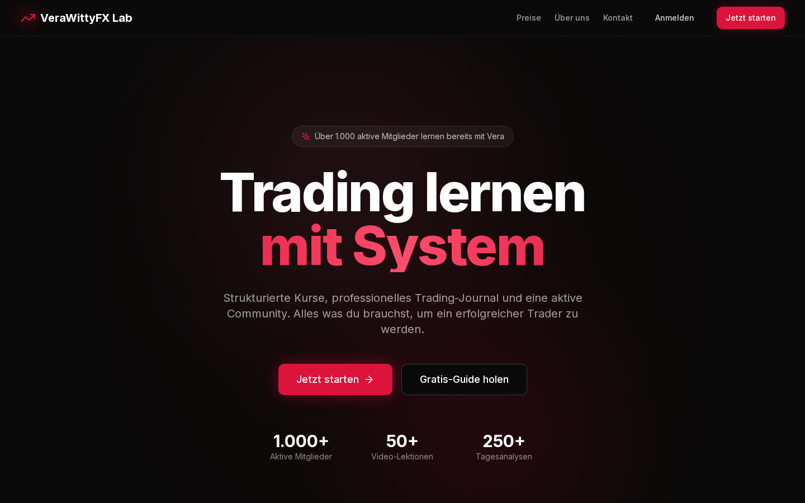
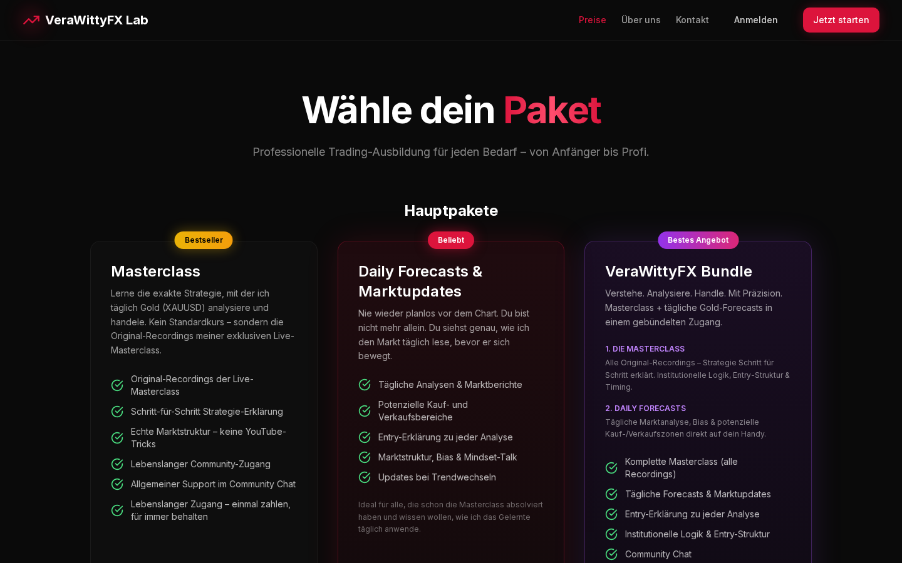
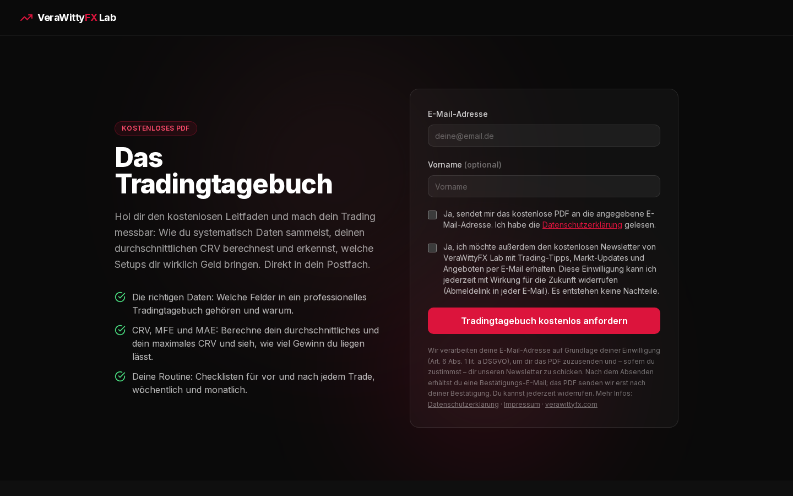
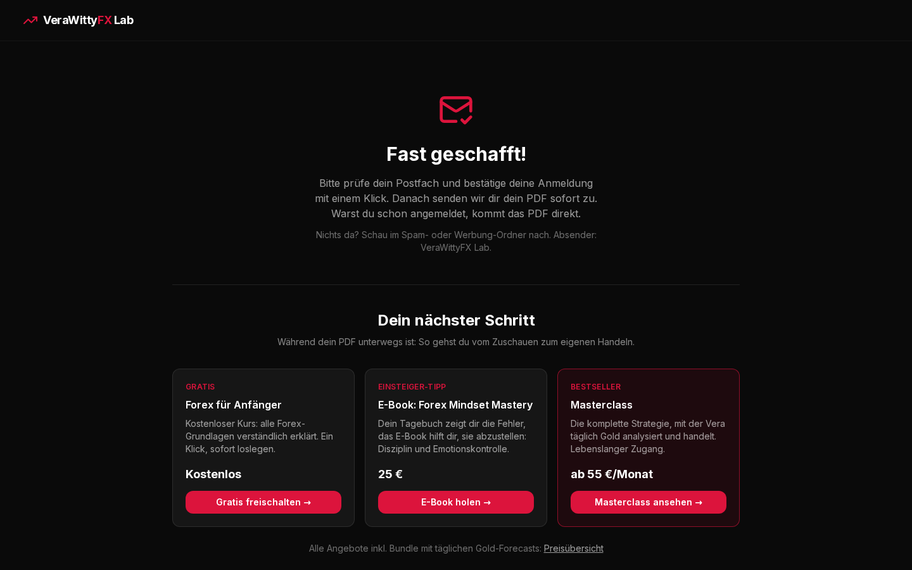
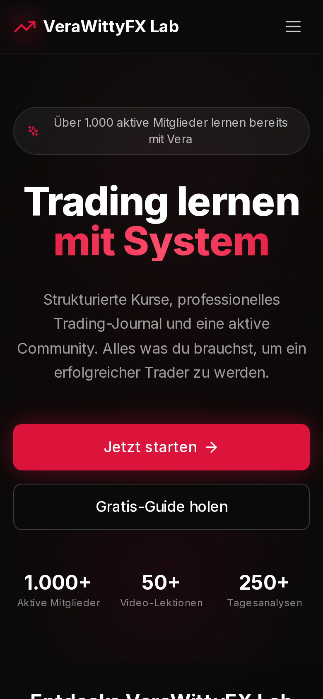
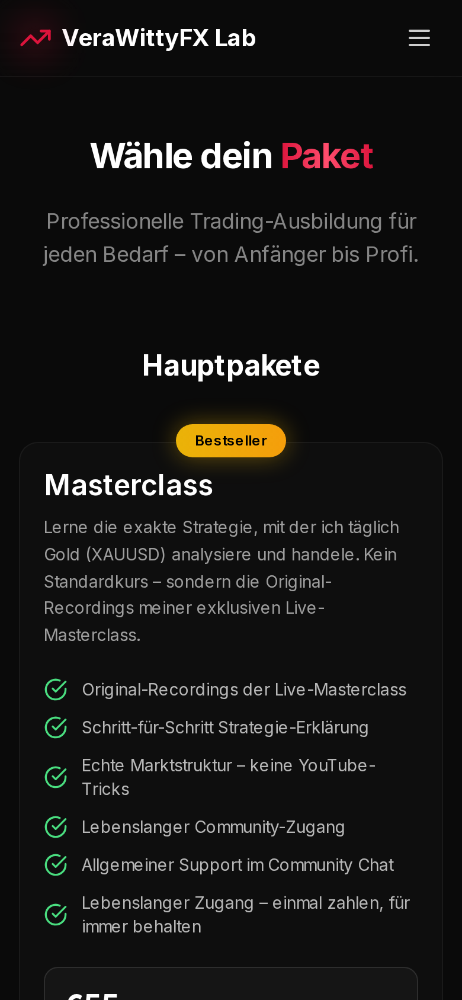
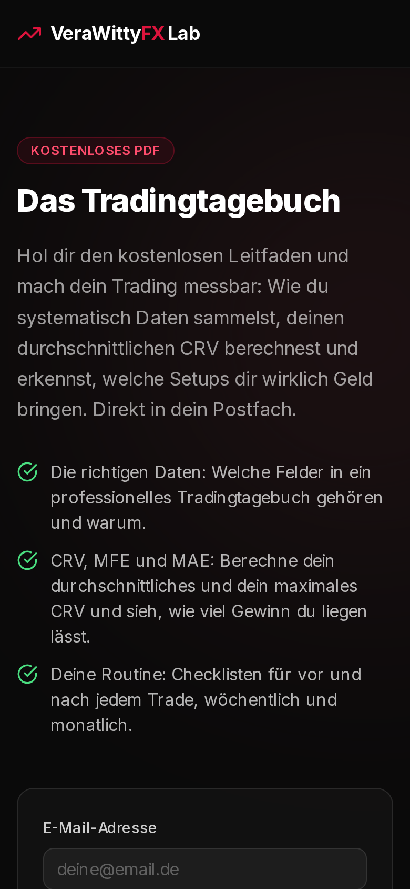
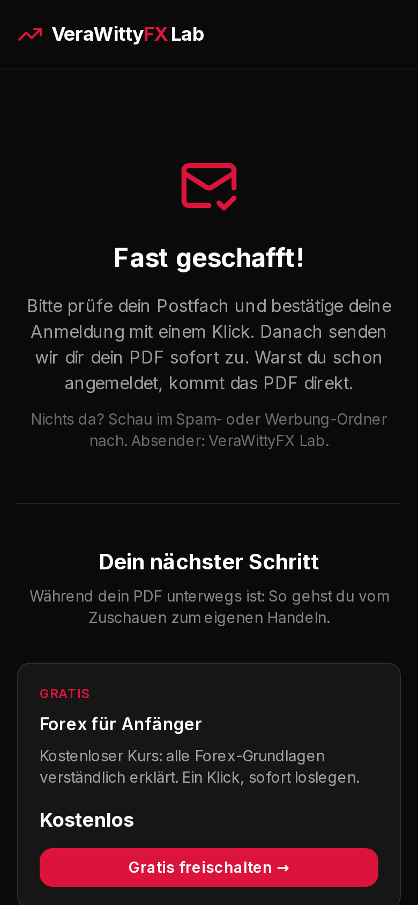
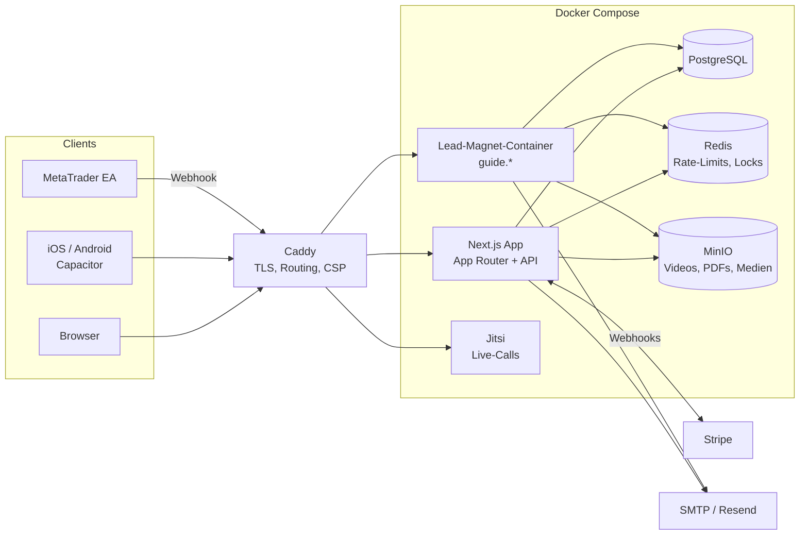

  

  <b>Full-Stack Trading-Education-Plattform</b> mit Kursen, täglichen Marktanalysen, Live-Calls, 
  Community, Trading-Journal mit MetaTrader-Sync, Abo- und Ratenzahlungs-Billing und nativer Mobile-App.

  
  
  
  
  
  
  
  

  <a href="https://verawittyfx.com">Live ansehen</a> ·
  <a href="#features">Features</a> ·
  <a href="#architektur">Architektur</a> ·
  <a href="#engineering-highlights">Highlights</a> ·
  <a href="#zugang-zum-code">Code</a>

---

## Auf einen Blick

| | |
|---|---|
| **Status** | Seit 2026 produktiv im Einsatz |
| **Umfang** | ~123.000 Zeilen TypeScript · 89 Seiten · 244 API-Routen · 78 Datenmodelle |
| **Automatisierung** | 20 Cron-Jobs für Billing, Mahnwesen, Benachrichtigungen, Sync und Monitoring |
| **Qualität** | 524 Tests (Vitest), strikte TypeScript-Prüfung, Produktions-Build als Gate |
| **Plattformen** | Web (responsive) · iOS · Android (Capacitor) · Web-Push |

## Screenshots

<table>
  <tr>
    <td width="50%"></td>
    <td width="50%"></td>
  </tr>
  <tr>
    <td align="center">Startseite</td>
    <td align="center">Pakete & Checkout-Einstieg</td>
  </tr>
  <tr>
    <td width="50%"></td>
    <td width="50%"></td>
  </tr>
  <tr>
    <td align="center">Lead-Magnet (isolierte Subdomain, DSGVO-Double-Opt-In)</td>
    <td align="center">Danke-Seite mit Cross- und Upsell</td>
  </tr>
</table>

  
  
  
  

## Features

**Lernen & Inhalte**
- Video-Kurse und Lernpfade mit Fortschritt und Zertifikaten (PDF)
- Sicheres HLS-Video-Streaming mit signierten URLs aus MinIO, inkl. Upload-Pipeline und Transcoding
- Tägliche Marktanalysen (Video + Chart-Snapshots) mit TradingView-Einbettung und Benachrichtigung
- Live-Calls über selbst gehostetes Jitsi mit Handheben, Viewer-Tracking und Aufzeichnungen
- Wirtschaftskalender mit Erinnerungen

**Community**
- Echtzeit-Chat mit Kanälen, Antworten, Pins, Bild- und Sprachnachrichten
- Ankündigungskanäle, Rollen- und Paket-basierte Zugriffsrechte, Discord-Integration

**Trading-Journal**
- Trades erfassen oder importieren (CSV/HTML, EU-Formate, UTF-16)
- Automatischer Sync mit MetaTrader 4/5 (Expert Advisor + Webhook) und cTrader
- Kennzahlen wie CRV, Trefferquote, Erwartungswert und Drawdown, Währungsumrechnung über EZB-Kurse

**Billing & Monetarisierung**
- Stripe-Integration für Abos, Lifetime-Käufe und Ratenzahlung
- Guest-Checkout mit Registrierungscode, Gutscheine, Rechnungen
- Automatisiertes Mahnwesen und laufender Abgleich mit Stripe
- Affiliate- und Referral-Programm mit Provisionsfreigabe
- Lead-Magnete auf eigener Subdomain mit Double-Opt-In, PDF-Auslieferung und Newsletter

**Sicherheit & Datenschutz**
- Verschlüsselung personenbezogener Daten auf Feldebene
- Zwei-Faktor-Authentifizierung und sichere Session-Verwaltung
- Mehrschichtiger Schutz vor Missbrauch und automatisierten Angriffen
- Einwilligungs-Protokoll (Art. 7 DSGVO), Datenexport und Löschung durch Nutzer

## Architektur

## Engineering-Highlights

- **Robuste Zahlungsabwicklung:** Webhook-Verarbeitung, die gegen Änderungen der Stripe-API abgesichert ist, plus automatischer Abgleich, der Abweichungen selbstständig erkennt und korrigiert.
- **Zuverlässige Benachrichtigungen:** E-Mail, Web-Push und In-App aus einer zentralen Pipeline, mit Wiederholung bei Fehlern und Versand, der Deployments übersteht.
- **Skalierbare Medien:** Video-Upload, Transcoding und HLS-Streaming mit signierten, zeitlich begrenzten URLs.
- **Isolierte Landingpages:** Öffentliche Marketing-Seiten laufen getrennt vom Kernsystem, aus demselben Build.
- **Eine Codebasis für Web, iOS und Android** über Capacitor, inklusive Push-Benachrichtigungen.

## Tech-Stack

| Bereich | Technologie |
|---|---|
| Frontend | Next.js 16 (App Router), React 18, TypeScript, Tailwind CSS, shadcn/ui |
| Backend | Next.js Route Handlers, Prisma 5, PostgreSQL 15, Redis 7 |
| Medien | MinIO (S3-kompatibel), HLS-Streaming, FFmpeg, pdf-lib |
| Zahlungen | Stripe (Payment Element, Checkout, Subscriptions, Webhooks) |
| Kommunikation | Nodemailer (SMTP), Resend, Web-Push, Jitsi |
| Mobile | Capacitor 7 (iOS & Android) |
| Infrastruktur | Docker Compose, Caddy 2, Cron-gesteuerte Jobs |
| Qualität | Vitest, Zod-Validierung, TypeScript strict |

## Zugang zum Code

Der Quellcode liegt in einem privaten Repository. Zugang gibt es auf Anfrage für Kunden, Partner und Recruiter.

**Kontakt:** [reinert-digital.de](https://reinert-digital.de)

---

  Entwickelt von <a href="https://reinert-digital.de"><b>Reinert Digital Solutions</b></a> 
  Showcase-Repository. Code, Inhalte und Marke VeraWittyFX sind urheberrechtlich geschützt.

